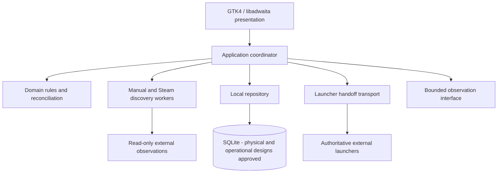

# Language, runtime, and application architecture decisions

**Status: A–D approved by owner engineering review.** Original evaluation date:
2026-10-25. Approval is limited to the choices and boundaries recorded below. The
[foundation](README.md), [domain](domain-model.md),
[discovery](discovery-contract.md), and [launch](launch-contract.md) contracts
remain authoritative. The retained comparison contains engineering judgments
informed by the linked primary documentation; it is not a benchmark or integration
test. Engineering authorship of that analysis is unchanged by owner approval.

## Approved decisions and boundaries

The table records the scope of the original A–D review. The subsequent
[physical SQLite design approval](sqlite-schema-proposal.md) independently
establishes the catalog, canonical protocols and specified guard/seal baseline.
The schema deferral under D describes that earlier approval checkpoint; it does
not reopen the now-approved design or approve operational settings by implication.
The subsequent [SQLite operational approval](sqlite-operational-policy.md)
separately resolves connection ownership, serialized IMMEDIATE writes, WAL/FULL,
contention/checkpoint values, crash recovery, backup mechanics and process ownership
at design level. It does not alter the original A–D approval scope in this table.

| Decision | Status | Approved choice | Approval boundary |
| --- | --- | --- | --- |
| A: Language/runtime | Approved | Stable Rust, edition 2024, Cargo, standard workers without Tokio initially. | The core must remain independently testable without GTK, SQLite, or live launchers. Types help constrain states; executable tests must still establish reconciliation correctness. |
| B: Application structure | Approved | Application-local core, built-in adapters, bounded workers, serialized state mutations. | Core testability remains mandatory. This does not approve synchronization scheduling or detailed process identity mechanisms. |
| C: Desktop UI | Approved | GTK4/libadwaita using Rust bindings. | Respect GTK main-thread requirements. Blocking discovery, database operations, and handoff work stay outside the UI thread, with results returned safely for presentation. Detailed UI design remains open. |
| D: Persistence | Approved | SQLite, relational separation of records and evidence; physical schema deferred. | No particular schema, migration strategy, connection model, or retention policy is approved. Claim provenance, stable identities, uncertainty, and justified supersession remain mandatory. |

The owner approved A–D based on the comparison presented in the assistant's message
and the established contracts. The owner explicitly stated:

> I have reviewed the comparison in your message, not independently inspected the local `architecture-options.md` file.

This records engineering approval of the four choices, not independent review or
blanket approval of every detail in this file. Module layouts, the connection/write
coordination model, attempt-persistence sequencing, and other detailed proposals
below remain engineering proposals wherever not expressly covered by A–D or the
subsequent physical-design or operational-policy approvals.

The next action authorized by this review is documentation only. Architecture
approval does not authorize implementation, live launcher execution, or public
push. The 24 synthetic cases remain behavioral requirements and have not become
executed tests through approval.

## Evaluation basis retained from the proposal

Before approval, the contracts constrained truth and authority without selecting a
language, toolkit, process topology, or storage engine. All shortlisted options
can satisfy the contracts. The recommendation weighed maintainability, explicit
state modeling, testability without a desktop session, local integration complexity,
contributor effort, and Linux distribution constraints. There is no evidence yet about future
maintainers' language preferences, library scale, or performance targets, so no
numeric scores, staffing assumptions, or performance rankings are assigned.

## Concrete stack alternatives

SQLite is a candidate for each stack, not a unique benefit of Rust. Comparisons
below are engineering judgments; supporting platform facts are linked afterward.

| Candidate | Shape and contract fit | Material benefits | Material costs and risks | Prefer when |
| --- | --- | --- | --- | --- |
| **Rust + GTK4/libadwaita** | Compiled Rust domain/core; GTK objects confined to the UI; adapters and storage in application modules. Enums and distinct ID types can make uncertainty and authority boundaries explicit. | One application language; domain tests can avoid GTK dependencies; direct Linux desktop integration through GLib/GIO; no application WebView boundary. | Rust ownership and GTK/GObject patterns both need contributor learning. Native GTK/libadwaita development libraries are required. The visual language is GNOME-oriented; it will not automatically match every desktop's theme. Compilation and binding/version coordination add maintenance work. | Linux desktop focus and durable typed core are more important than minimizing initial coding effort. **Recommended.** |
| **Python + PySide6 + Qt Quick/QML** | CPython domain/services, explicit dataclasses/enums and validation, Qt model bridge to QML, workers using Qt signals. | Likely shortest path to implementing and iterating read-only discovery; Qt Quick is well suited to an artwork grid and custom layouts. No Rust ownership learning. | Python, Qt, QML, and binding/runtime dependencies must be distributed together or supplied compatibly. Type annotations alone do not enforce runtime contracts; validation and static checks need discipline. Qt/Python object lifetimes and threads still need care. | Fast iteration and Python familiarity dominate. This is the strongest alternative if maintainers prefer Python. |
| **C++ + Qt 6 + Qt Quick/QML** | C++ core/application with explicit domain types and Qt models; QML presentation; CMake build. | Direct Qt integration without Python bindings; rich declarative presentation and model/view support. Strong fit for an experienced Qt contributor base. | C++ lifetime, memory, and concurrency discipline remain substantial responsibilities; QML adds a second language boundary. Native compiler/toolkit builds and module licensing need attention. No current requirement specifically benefits from choosing C++. | Maintainers already have sustained C++/Qt expertise or custom Qt presentation becomes a priority. |
| **Rust + Tauri 2 + TypeScript UI** | Rust owns domain, storage, and OS access; a bundled local HTML/CSS/TypeScript frontend communicates through commands/events. A concrete UI candidate is Svelte with Vite. | Retains a typed Rust core and provides familiar web layout tools; UI can evolve independently of Rust internals. | Rust and web toolchains; serialized IPC state must preserve unknowns and attempt identities. Linux depends on WebKitGTK. Core/WebView permissions, payload validation, and ordering add another boundary to maintain. This is a multi-process runtime even without a backend daemon. | Web UI expertise and visual customization outweigh the additional runtime and IPC work. |

Rust's enums support variants with data; this is a useful implementation tool for
the existing state distinctions, not proof that reconciliation is correct.
[Rust enum documentation](https://doc.rust-lang.org/book/ch06-00-enums.html)
describes the mechanism. Conversely, Python's
[dataclass documentation](https://docs.python.org/3/library/dataclasses.html)
explicitly notes that annotations are generally not inspected for their types.
Python can implement the same contract with explicit validation, tagged values,
tests, and static checking; it is not disqualified by dynamic typing.

[Qt Quick](https://doc.qt.io/qt-6/qtquick-index.html) supplies QML views, models,
visual components, and a C++ extension API. The
[Qt for Python QML tutorial](https://doc.qt.io/qtforpython-6/tutorials/qmlapp/qmlapplication.html)
shows Python-to-QML data presentation, and
[QThread documentation](https://doc.qt.io/qtforpython-6/PySide6/QtCore/QThread.html)
explains worker objects and queued connections. These establish feasible building
blocks, not a measured development-speed advantage for Koiné.

Tauri documents its [core/WebView process model](https://v2.tauri.app/concept/process-model/)
and [Linux prerequisites](https://v2.tauri.app/start/prerequisites/), including
WebKitGTK development dependencies. The suggested Svelte frontend would add a web
build toolchain; it would not require shipping a Node server. UI commands should
express operations such as requesting a selected target, not expose arbitrary
shell execution or database writes. A chosen web framework would need its own
dependency/version review before scaffolding.

The language does not decide launcher delegation correctness. Every candidate
still needs supported Steam/Heroic formats, transport semantics, and carefully
limited process observations. Choosing Rust does not resolve these external facts.

## Application architecture alternatives

These choices are independent of the toolkit. Even a single application should
keep business rules out of widget callbacks.

| Structure | Benefits against the contracts | Costs and limits | Recommendation |
| --- | --- | --- | --- |
| **Application-local modules and workers** | One mutation coordinator can reconcile scoped results consistently. Pure core functions accept observations and produce decisions. UI-independent tests can cover failures without Steam or a desktop. | UI and application integration share a failure boundary. Background work ends when the application exits; recovery must preserve uncertainty. Slow filesystem/command operations still need bounded workers and honest cancellation. | **Choose for the first slice.** It satisfies established behavior with the fewest deployment/lifecycle components. |
| **Desktop UI + independent per-user service** | A service can own storage and observation while a UI disconnects; allows future multiple clients. | IPC protocol/versioning, service activation, shutdown, permissions, recovery, and separate logs/builds. Continued monitoring after UI exit would introduce a new lifecycle commitment. No existing requirement needs it. | Defer unless a concrete requirement calls for continued work without the app UI. Do not add a workstation service now. |
| **Application host + adapter subprocesses** | Adapter crashes can be isolated; potentially supports different integration languages. | Serialization and protocol versions for claims/coverage, subprocess lifecycle, cancellation, deployment, and compatibility. Isolation alone does not preserve source authority. | Defer until a real adapter needs isolation or a second implementation language. Built-in adapters are enough initially. |

An event-sourced system is another storage/orchestration option, not a requirement
of retaining provenance. It would introduce replay/versioning and projection
maintenance before the project needs them. Recommend ordinary persistent records
with enough observation/supersession evidence to explain current conclusions.
Avoid a generic plugin system, local HTTP API, dependency-injection framework, or
message broker for the first slice. Small explicit interfaces at actual I/O
boundaries provide the test seams needed here.

## Proposed module and runtime boundaries

The following is a proposed dependency direction, not an approved source tree.
Two Cargo packages are sufficient initially: a UI-independent core library, and
the desktop application containing UI and integration modules. Do not split every
adapter or domain concept into a separate package.

The core owns typed source/context IDs, separate records for the five concepts,
claim knowledge/freshness, coverage validation, reconciliation, and the two launch
state axes. It depends on data and narrow interfaces, not GTK, filesystem layouts,
SQL rows, command templates, or launcher configuration. The application passes in
time/ordering evidence; tests supply deterministic values rather than sleeping.

The application coordinates bounded discovery and launch operations, validates
results, and serializes changes to library/attempt state. Workers perform blocking
reads or transport operations and return scoped data. Arrival order remains
different from evidence order under R6. The UI displays committed conclusions and
explicit pending operations; it must not optimistically label a game running.

For the approved GTK option, the GLib main loop owns widgets. Discovery,
database I/O, and command waiting must not block that loop. A bounded worker
mechanism passes ordinary data back through GLib-compatible notifications; exact
queue/channel libraries remain implementation details. The separately approved
[operational policy](sqlite-operational-policy.md) now selects dedicated reader and
writer workers with a bounded writer queue and serialized semantic transactions.
Blocking storage work stays off the UI thread. GTK's
[threading rules](https://docs.gtk.org/gtk4/section-threading.html) and the gtk-rs
[event-loop guidance](https://gtk-rs.org/gtk4-rs/stable/latest/book/main_event_loop.html)
support this separation. Tokio is a feasible later choice if an approved dependency
requires it; it is not needed solely for the current local-file slice.

Jobs start on explicit application operations. No periodic synchronization,
autostart daemon, or continued observation after application exit is proposed.
Cancellation stops Koiné work where possible and records partial/inconclusive
results; it must not kill an externally launched game or change its launcher
configuration. Launch forwarding can outlive a bounded wait; a timeout cannot be
turned into definite command failure merely to simplify shutdown.

There is no atomic transaction spanning Koiné's storage and an external launcher.
Propose recording attempt intent before issuing handoff, then recording the actual
transport result separately. A crash around submission may leave disposition
unknown: recover as inconclusive with its evidence and never automatically replay
the command. An intent record is not proof that a request reached the launcher.
If intent persistence fails, report that preflight failure before submission.
If submission occurred but result persistence fails, do not claim that no handoff
occurred. This sequencing is now covered by the separate physical-design approval;
it provides no exactly-once execution guarantee.

## Persistence alternatives and original approval scope

This comparison and D's original scope are retained as historical rationale.
The later [physical design baseline](sqlite-schema-proposal.md) supersedes schema
deferral; the separate [operational policy](sqlite-operational-policy.md) resolves
connection ownership, durability, contention, checkpointing, crash recovery and
backup mechanics. Migration/schema upgrades, evidence retention, backup
administration/restore, and packaging/runtime supply remain open.
The paragraphs below describe what D alone selected, not a present need to obtain
physical-design approval again.

| Option | Fit and material tradeoff |
| --- | --- |
| **SQLite relational records** | Can represent independent entries, access claims, installations, targets, evidence, and scan/attempt bookkeeping with transactions and referential constraints. Requires deliberate schema/migration design, unknown-state encoding, and write coordination. **Recommended.** |
| **Versioned JSON document files** | Easy to inspect and initially small dependency surface. Must implement consistent cross-record updates, crash recovery, migration, locking, and query/index behavior as relationships grow. Adequate for fixtures; less attractive for the primary library store. |
| **Client/server database** | Useful for independently connected concurrent clients; adds a service, credentials/configuration, and distribution/administration work without an established local-library requirement. Not recommended for the first slice. |

SQLite's own [use-case guidance](https://www.sqlite.org/whentouse.html) includes
local desktop application storage, and its
[transaction documentation](https://www.sqlite.org/transactional.html) describes
atomic database updates. Those capabilities support R7; they cannot determine
whether a source omission is authoritative or make external handoff atomic.
The [foreign-key documentation](https://www.sqlite.org/foreignkeys.html) requires
explicit runtime enforcement rather than assuming a default setting.

Approval D selects the engine and relational direction only; it does not approve
a migration strategy, connection model, or retention policy. The next schema
proposal must show scoped uniqueness, recoverable knowledge/freshness and dispute,
evidence/supersession links, coverage, attempt/process separation, and migration
behavior. It must not reduce the library to one mutable game row. SQL table names,
column layouts, indexes, retention limits, journal settings, and the Rust SQLite
binding are not selected here. A small direct SQL implementation is preferable to
adding an ORM before its benefit is demonstrated; the binding can be chosen once
the schema and build constraints are reviewed.

## Testability against the existing contracts

| Contract pressure / existing cases | Proposed implementation boundary and verification |
| --- | --- |
| Five concepts; multiple stores, editions, accounts, installations | Distinct core types and scoped references; run the domain cases without GUI or launcher dependencies. Type distinctions help prevent accidental swaps but do not prove matching correctness. |
| Partial, failed, changing, cancelled, or unsupported scans | Adapter result includes requested/inspected scope and outcome; core reconciliation tests preserve prior claims. Fault-injected file readers test malformed/inaccessible data separately from semantic fixtures. |
| Stale or conflicting evidence; delayed and duplicate results | Inject clock/order inputs; core tests check timestamp preservation, scoped supersession, and unresolved conflict. Serialized application mutation alone is insufficient. |
| Persistent library recovery | Repository tests use a temporary database, close/reopen it, and verify identities, relationships, provenance, uncertainty, and migration behavior. No database engine can substitute for these tests. |
| `sprawl-exit-127` | Fake transport returns definite failure/status 127; assert failed handoff and no observed process or invented session. A separate synthetic helper can test actual OS exit-status handling without launching Steam. |
| Accepted handoff, timeout, observer loss, PID reuse | Inject transport and observer evidence independently. Unsupported observation reports inconclusive. Select a real identity method only after its separate design/evidence review. |
| Missing artwork | Optional presentation data is outside the handoff dependency chain; test that missing/failed metadata leaves a valid launch operation available. |

When implementation is separately authorized, translate applicable portions of
all 24 specifications into core tests and identify the adapter/storage/UI portions
that still need their respective implementation. Rust supports separate
[library unit and integration tests](https://doc.rust-lang.org/book/ch11-03-test-organization.html).
Do not count a fixture-based test as live Steam/Heroic verification, and do not
claim an unimplemented storage or UI case passed just because its pure rules did.

## Rationale and tradeoffs retained from the proposal

Rust increases initial implementation and contributor learning effort relative to
the Python candidate. GTK adds GObject/main-thread integration work rather than
eliminating it. This recommendation prioritizes a typed, testable core and a small
Linux desktop runtime boundary over the quickest visual prototype. If maintainers
expect primarily Python contributions, that preference is a sound reason to choose
Python/PySide6 instead; no measured productivity data resolves it today.

Libadwaita describes itself as
[building blocks for GNOME applications](https://gnome.pages.gitlab.gnome.org/libadwaita/doc/main/).
Choosing it is a visual/toolkit direction, not a requirement to run GNOME. GTK
documents [Wayland](https://docs.gtk.org/gtk4/wayland.html) and
[X11](https://docs.gtk.org/gtk4/x11.html) backends, but backend availability depends
on the shipped build. Validate supported sessions and desktop integration instead
of forcing a compositor, GPU, backend, or theme. Accessibility, keyboard navigation,
image loading, startup time, memory, and large-library responsiveness still need
product tests; none is established by toolkit selection.

A Rust binary using GTK is not a self-contained universal Linux executable.
[GTK compilation documentation](https://docs.gtk.org/gtk4/compiling.html) describes
native-library/build requirements. Minimum runtime/library versions and packaging
remain open. A sandboxed package may change visibility of library directories,
launcher access, and process evidence; a toolkit choice does not solve those
constraints. Distribution decisions must be tested against discovery and handoff
before promising support. Do not install workstation packages during this decision
review or choose version floors from the development machine.

Dependencies keep their own licenses. Libadwaita's documentation lists
LGPL-2.1-or-later; [Qt for Python](https://doc.qt.io/qtforpython-6/) lists
LGPLv3/GPLv3/commercial options, and
[Qt's licensing documentation](https://doc.qt.io/qt-6/licensing.html) distinguishes
modules with different terms. Preserve Koiné's MIT license; review actual selected
modules, linking/bundling, and notices before release. This evaluation is not
distribution clearance and does not assume a paid Qt license is necessary.

## Remaining decisions and work authorization

A–D resolve the language/runtime, application structure, toolkit, and storage-engine
choices within the recorded boundaries. They do not authorize implementation in
this documentation-only next step. No application scaffolding, dependency manifests,
dependency installation, migrations, or live launcher execution belong in this pass.

Packaging/distribution, ownership API authentication,
periodic/background synchronization, process-monitoring method, specific launcher
transports, detailed UI design, migration strategy, retention
policy, automatic cross-store matching, and freshness policies remain open.
Physical schema, canonical protocols and specified guards/sealing now have
separate design approval; executable correctness and the required serialization
vectors and guard/conformance validation remain unverified. The separate
[operational policy](sqlite-operational-policy.md) has design-level approval;
its conformance obligations remain unexecuted. Backup scheduling, destination
selection and restoration, repair tooling, and the verified runtime-supply
mechanism remain open. Source formats and transports still need the
[integration evidence work](integration-evidence.md). These do not prevent core
tests or an honest inconclusive process state once implementation is authorized,
but they do limit claims about completed integrations and the persistent desktop
slice.

Publication still requires separate authorization. Architecture approval and a
local documentation commit do not establish implementation or test completion.

## Decision history

- **Original evaluation, 2026-10-25:** A–D were proposed with alternatives, rationale,
  and open questions in local commit `2a7c309`. No architecture choice was approved
  at that checkpoint.
- **Subsequent owner engineering review:** The owner approved A–D as presented in
  the message comparison, with the boundaries recorded above, and explicitly did
  not claim independent inspection of this file. The owner requested a
  documentation-only record of approval. No implementation, executed-test, or
  publication status was advanced by that review.
- **Subsequent operational review, recorded 2026-10-27:** The owner approved the
  uploaded [SQLite operational policy](sqlite-operational-policy.md) at design
  level, including initial contention/checkpoint values. Backup completion/reader
  availability and transaction uncertainty remain explicit conformance obligations.
  This does not expand A–D's original approval scope or authorize implementation,
  runtime validation, or publication.
